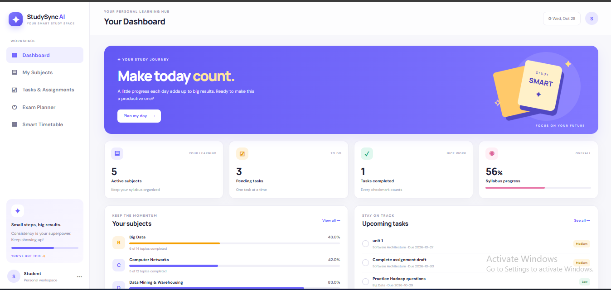
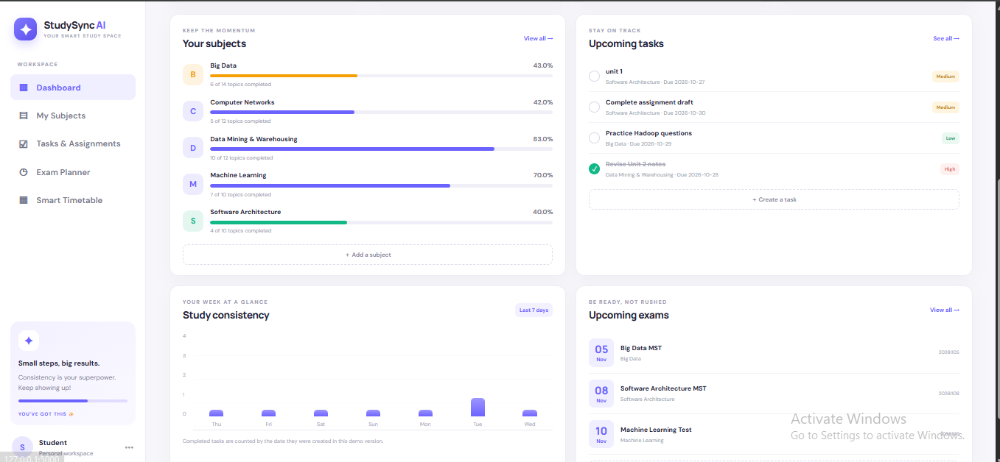
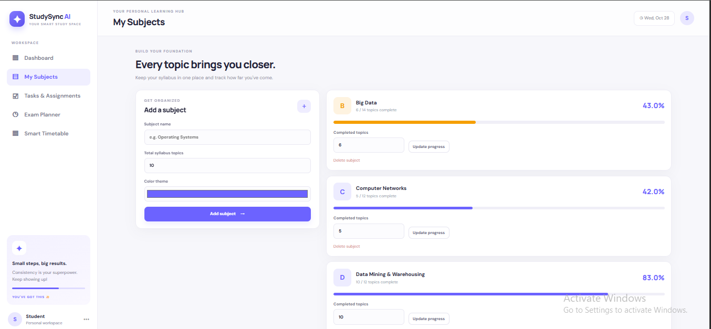
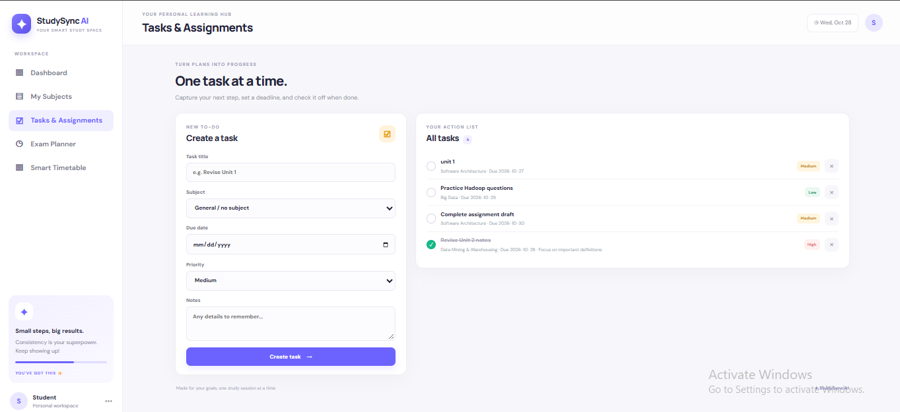
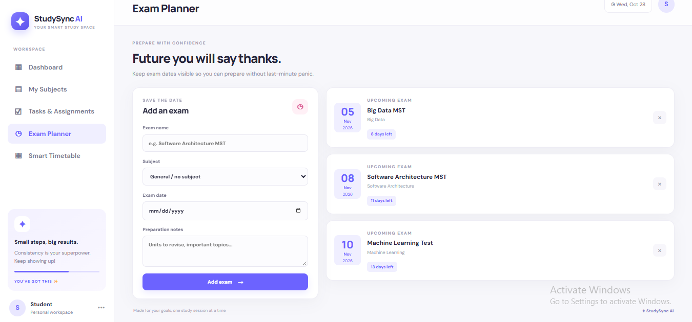
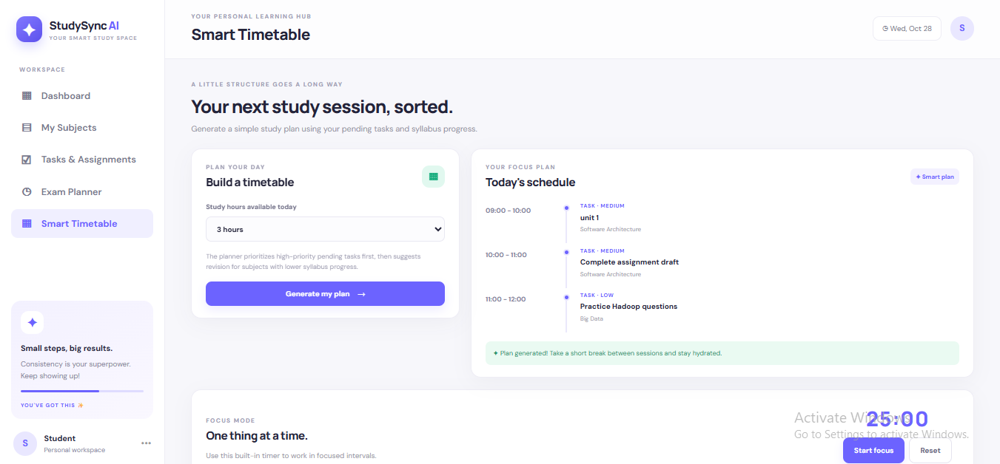

# StudySync AI – Smart Student Planner

A local, software-only student planner built with Python Flask, SQLite, HTML, CSS and JavaScript.

## Features
- Dashboard with subject progress and task summaries
- Add subjects and update completed syllabus topics
- Create, complete and delete tasks with due dates and priorities
- Add upcoming exams and view countdowns
- Generate a basic study timetable based on pending tasks and syllabus progress
- Built-in 25-minute focus timer
- Responsive layout for desktop and mobile
- SQLite database is created automatically on first run

## Requirements
- Python 3.10 or newer
- Internet connection only for loading Google Fonts; the app itself runs locally

## Run on Windows
1. Extract the project folder.
2. Open the folder in VS Code.
3. Open Terminal → New Terminal.
4. Run:

   ```bash
   python -m venv venv
   venv\Scripts\activate
   pip install -r requirements.txt
   python app.py
   ```

5. Open http://127.0.0.1:5000 in your browser.

If `python` does not work, try `py app.py` after installing Flask with `py -m pip install -r requirements.txt`.

## Database
The `studysync.db` file is automatically created beside `app.py`. Keep it if you want to preserve your data. To reset the demo data, stop the server and delete `studysync.db`; it will be recreated on the next launch.

## Notes
This is an academic prototype intended to run locally. The timetable generator is a simple rule-based planner, not a machine-learning model. Add authentication and production security before deploying publicly.
## Screenshots

### Dashboard





### My Subjects



### Tasks & Assignments



### Exam Planner



### Smart Timetable

